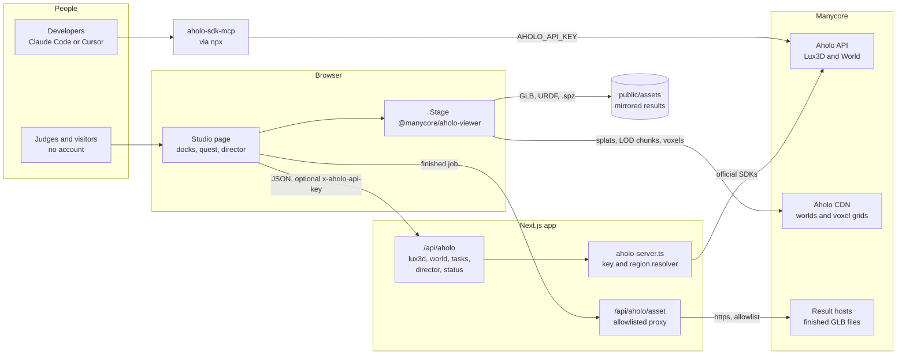
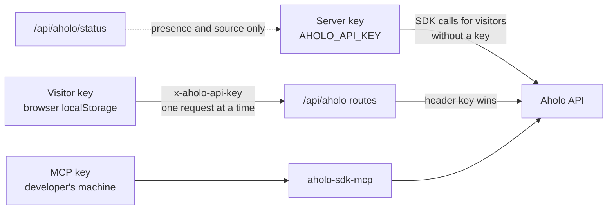
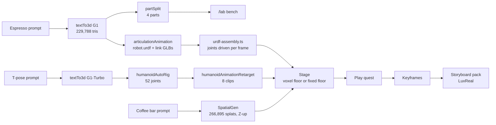
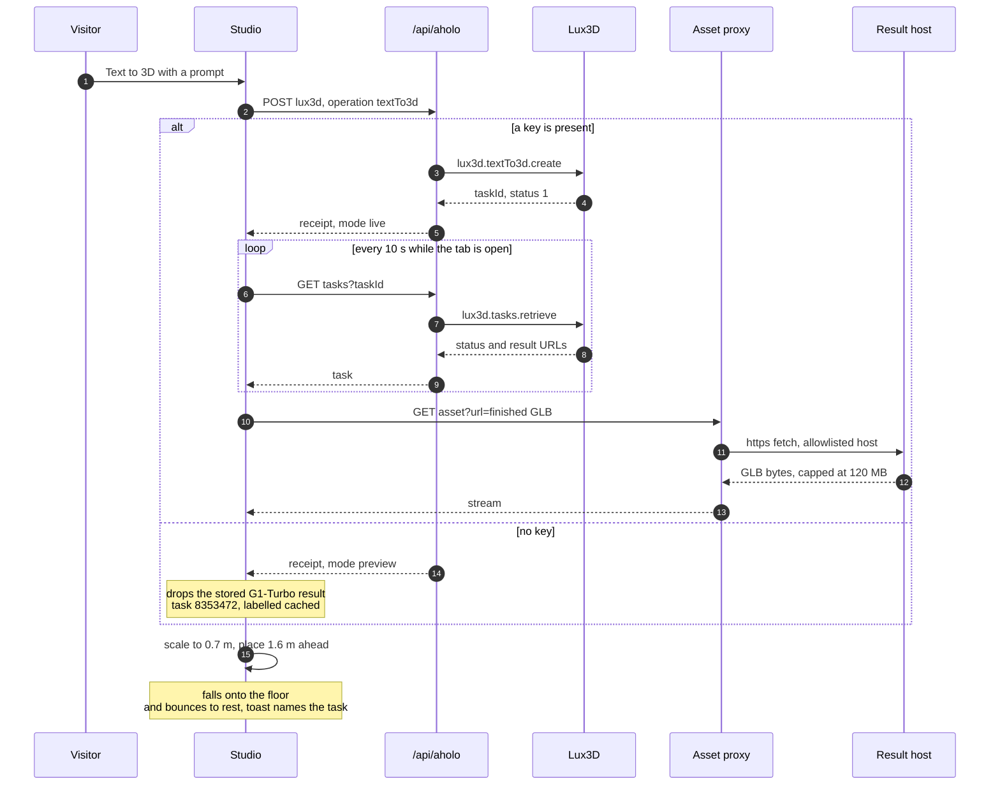
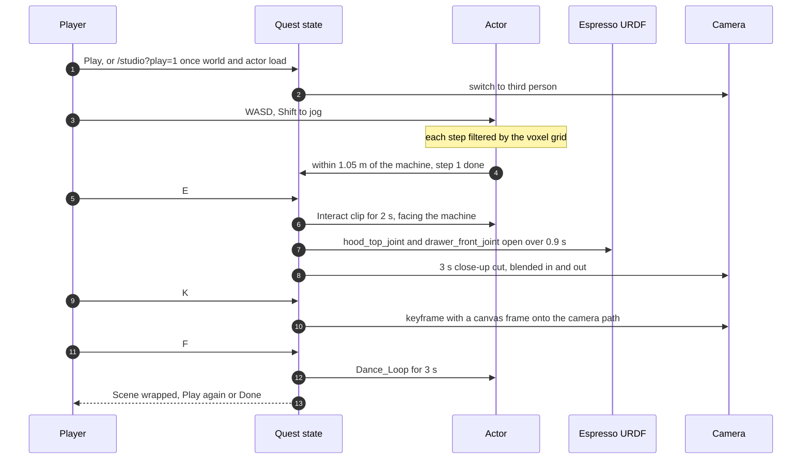
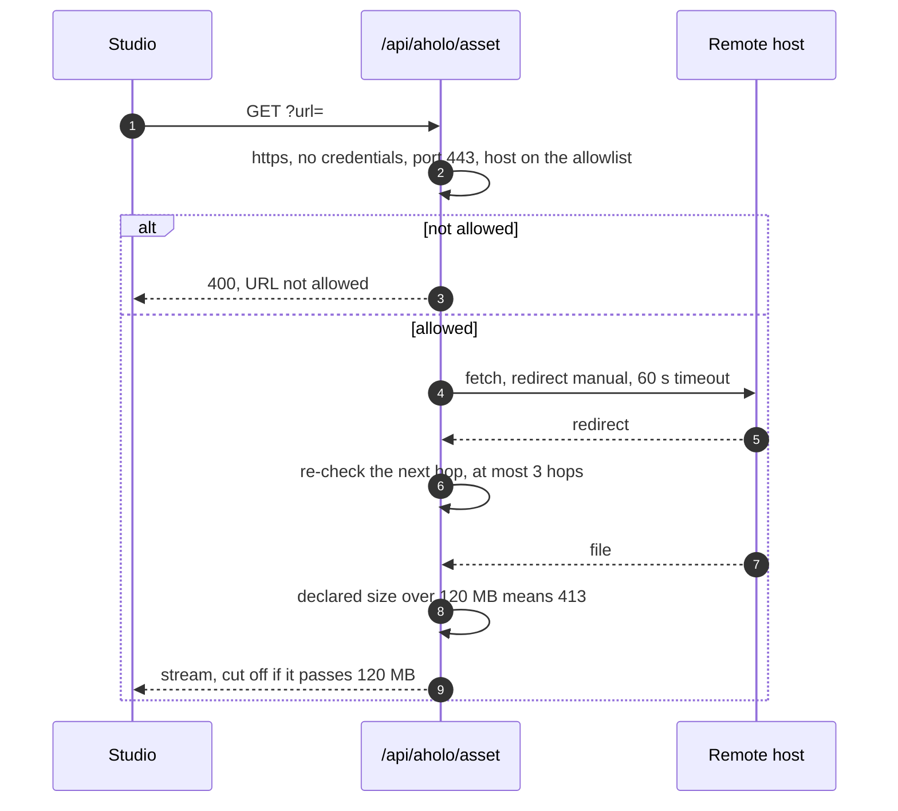
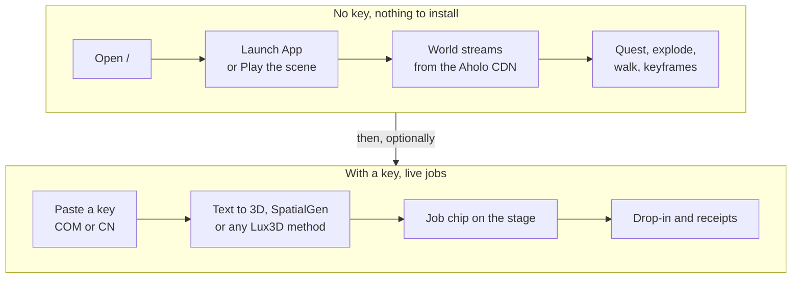

# Holorra

**A browser studio where generated 3D becomes a scene you can walk through, take apart, play and film.**

Holorra puts 3D Gaussian Splatting (3DGS) worlds, Lux3D props that come apart and move, an auto-rigged actor you control, and a camera director on one WebGL2 stage, built on the official Manycore Aholo SDKs. One rule decides what goes on that stage: **every asset is a real Aholo output, and anything that is not is labelled.**

Built for the Manycore Aholo Global 3D AI Hackathon · `#Manycorehackathon` · App: `<LIVE_URL>` · Demo: `<VIDEO_URL>` · Code: [github.com/mrnetwork0001/Holorra](https://github.com/mrnetwork0001/Holorra)

**Judges, start here:** `<LIVE_URL>/studio?play=1` starts a one-minute scene quest with no key and no sign-up. Every real Lux3D result is live in 3D at `/lab`, and the docs (13 pages, including the HTTP API and an honest Limits & FAQ) are at `/docs`.

---

## Four verbs, no API key needed

| Verb | What it is | Try it without a key |
| --- | --- | --- |
| **Generate** | Five 3DGS worlds open with no wait. Four stream from Manycore's content delivery network (CDN), up to a **41.8M-splat** level-of-detail (LOD) stream in 528 chunks. The fifth, a **Scandinavian coffee bar**, came back from one SpatialGen sentence in **625 s** as 266,895 splats (world `3FO4K4V99KMD`). | `/studio?world=spatialgen-coffee-bar`, or the world tabs in the studio header |
| **Split** | One prompt became an espresso machine on Lux3D G1 (229,788 triangles, 3 PBR maps). `partSplit` broke it into **4 parts** with the same triangle count, and one sentence to `articulationAnimation` returned a URDF (robot description file) with a **revolute hood hinge (0 to 90°)** and a **prismatic drawer**. Explode it (Closed, Inspect, Service, CAD), isolate a part, recolor it. | `/studio`, right dock: Parts. Or `/lab` for the bench. |
| **Play** | A static character mesh went through `humanoidAutoRig` (**52 joints**) and `humanoidAnimationRetarget` (**8 clips**). Press Play: walk it to the machine, press **E** to brew (the camera cuts in while the URDF hood and drawer open), **K** to frame the shot, **F** to celebrate. *The machine you brew on is the one Lux3D generated, and the hinge that opens is the one Lux3D inferred.* Phones get a thumb joystick. | `/studio?play=1` |
| **Direct** | Keyframes store camera position, target, duration and a shot prompt with a frame grabbed from the canvas. Playback follows a Catmull-Rom spline. Export a storyboard pack (`manycore.aholo.luxreal.storyboard.v1`) and a master prompt for LuxReal's video creator. | Press **K** anywhere, then **Play path** and **Storyboard JSON** under the stage |

### More to explore

| Feature | What it is | Where |
| --- | --- | --- |
| **Drop-in** | Press Text to 3D and keep playing. A chip on the stage tracks the job; when Lux3D finishes, the model is fetched through an allowlisted proxy, scaled to about 70 cm and dropped 1.6 m in front of you, landing on the floor. Without a key, our stored G1-Turbo result (task 8353472) drops in, labelled *cached*. | `/studio`, left dock: Lux3D, Text to 3D |
| **Lux3D bench** | Every Lux3D result in a live viewer: turntable, explode with a measured part table, URDF joint sliders, an 8-clip switcher, G1 vs G1-Turbo side by side, and both rig attempts (the rejected one too). Plus the full run log. | `/lab` |
| **Live generation** | All 10 Lux3D methods, SpatialGen and Aholo Reality from the left dock. Every call leaves a receipt with its SDK method, task or world ID and mode (live, preview, cached, CDN preset). | `/studio` (a key is needed for live jobs) |
| **Co-director** | Describe the scene in plain language; it returns an ordered plan of Aholo MCP (Model Context Protocol) tool calls and updates the stage to match. Deterministic keyword planner, no LLM key. | `/studio`, right dock: Co-director |
| **MCP hub** | `.mcp.json` for Claude Code, Claude Desktop and Cursor, CLI setup, and a playground showing each tool's schema and sample arguments. | `/mcp` |
| **Expand** | Hides the docks, header and timeline and gives the render the whole screen; browser fullscreen where allowed, a fixed full-window stage elsewhere. | Stage toolbar, far right |
| **Project report** | The submission deck: problem, pipeline, real results, comparisons, rubric. Prints to PDF one slide per page. | `/report`, also `docs/Holorra-Project-Report.pdf` |
| **Docs** | 13 pages: welcome, how it works, worlds, play mode, parts, actors, director, live generation, real results, MCP, HTTP API, deployment, limits & FAQ. | `/docs` |

The studio header holds the five world tabs, links to Studio, Report, MCP and Docs, render settings (splat exposure, sort mode) and the **API key** field with a COM / CN region switch. The stage toolbar has Play, the camera mode (orbit, third person, first person, path), Keyframe, reset camera and Expand. At 900 px and below, the docks move into a left drawer behind a burger button and the stage gets a touch joystick with Brew, Frame and Cheer buttons. Nothing anywhere needs an account.

## Why Manycore Aholo is essential

Take out any part of the Aholo stack and a piece of the scene disappears with it.

- **No SpatialGen, no world 05.** The coffee bar is the `.spz` SpatialGen returned (`public/assets/spatialgen/coffee-bar.spz`), loaded as a preset in `src/config/aholo-presets.ts` and rotated from Z-up into Aholo's −Y-up frame.
- **No `partSplit` and `articulationAnimation`, no brew.** The quest's Brew step drives the joints in the URDF Lux3D returned (`public/assets/lux3d/articulated/robot.urdf`), assembled at runtime by `src/lib/urdf-assembly.ts`. There is no hand-made rig behind it.
- **No `humanoidAutoRig` and `humanoidAnimationRetarget`, no actor.** The only actor is the GLB from retarget task 8359816; its generic clip names (`animation_1` to `animation_8`) are mapped in the actor's `clipMap`.
- **No `@manycore/aholo-viewer`, no stage.** Splat files, chunk-LOD streaming, glTF skinning and animation all render in one viewer scene (`src/components/stage/AholoHybridStage.tsx`). Holorra has no renderer of its own.
- **No Aholo CDN, no zero-wait start.** Worlds 01 to 04 and their voxel collision grids stream from `holo-cos.aholo3d.cn`, so the studio is playable while live jobs take minutes.

## Architecture

Holorra has three layers:
- **The browser:** the stage, the docks, play mode and the camera director. Session state (keyframes, running jobs, dropped models) lives here.
- **The server:** one Next.js app. Routes under `/api/aholo/*` call the official SDKs, so keys stay on the server.
- **Manycore:** the Aholo API (Lux3D, World) and the Aholo CDN (hosted worlds, voxel grids, result files).

There is no database and no scheduler. Every job is started by a visitor, and the open studio tab follows it. Real results are mirrored into `public/assets/` so the app never depends on expiring result links. The diagrams render on GitHub; the docs at `/docs` cover each part in more depth.

### System overview



**One app, five surfaces.** `/` is the landing page, `/studio` the product, `/lab` the bench of real results, `/report` the deck and `/docs` the documentation. Pages that show results import them from `src/config/lux3d-results.ts`, so the landing page, bench, report and docs quote the same task IDs and times.

**Loading.** The stage is a client-only component (`dynamic(..., { ssr: false })`) because the viewer needs WebGL2 and module Web Workers. Switching worlds aborts in-flight requests and destroys the old splat before loading the next. Splat URLs are made absolute before they reach the viewer's worker, which runs from a blob URL and cannot resolve `/assets/...`.

### Who holds which key



| Key | Lives in | Can | Can never |
| --- | --- | --- | --- |
| Server key (`AHOLO_API_KEY`) | Server environment only | Start Aholo jobs for visitors who bring no key | Reach the browser: `/api/aholo/status` reports only whether a key exists and where it came from |
| Visitor key | The visitor's browser (local storage) | Start jobs on the visitor's own credits, sent per request as `x-aholo-api-key` | Be stored or logged by the server: routes pass it to the SDK for that request only |
| MCP key | The developer's shell or `.mcp.json` | Drive the 26 Aholo MCP tools from an editor | Ship in the repository: the committed `.mcp.json` holds a placeholder |

Header keys take precedence over the server key (`resolveAholoContext` in `src/lib/aholo-server.ts`). With no key from either source, routes never call Aholo and answer with a labelled preview.

### The core pipeline: prompt to scene



Each output is mirrored once into `public/assets/` (textures resized to 1024 px JPEG with glTF-Transform, geometry untouched) and placed by preset: the espresso machine stands on the loft floor found in the voxel grid (y = 1.912) and on a table in the coffee bar; the actor stands at the world's `actorSpot`.

### A live Text to 3D job, end to end



### The scene quest



The quest state lives in a ref read by the render loop; only step changes reach React, so the overlay does not re-render every frame.

### The safety path: the asset proxy



Allowed hosts: `holo-cos.aholo3d.cn`, and `kujiale.com`, `myqcloud.com`, `aholo.ai`, `aholo.cn` with their subdomains. It is not an open proxy.

### Visitor onboarding



**One run, end to end.** On 18 Nov 2026 the espresso prompt went through `textTo3d` on G1 (task 8353478, 343 s), `partSplit` (8354166, 118 s) and `articulationAnimation` (8354168, 298 s). The URDF from that last job is the file the Brew step drives today, and the same three results sit side by side on `/lab`.

## Safety and security

- **The server key never leaves the server.** Routes read `AHOLO_API_KEY` from the environment; `/api/aholo/status` returns `hasApiKey` and `keySource` (`header`, `env` or `none`), never the key.
- **A visitor's key is theirs.** It stays in their browser and goes only to Holorra's own routes, which hand it to the SDK for one request. No route logs request headers (there are no `console` calls under `src/app/api`).
- **No key, no outbound jobs.** Without a key, Lux3D requests return `INSTANT_STAGE_BLUEPRINT` previews and world requests return `VERIFIED_MANYCORE_CDN_PRESET` hosted worlds. Nothing is sent to Aholo and nothing is billed.
- **The asset proxy is narrow** (`src/app/api/aholo/asset/route.ts`): https only, a fixed host allowlist, every redirect hop re-checked, 60 s and 120 MB limits.
- **Nothing secret is committed.** `.env.local` is git-ignored, `.mcp.json` ships a placeholder, and the full git history was checked for the project key before pushing (18 Nov 2026: not present).
- **Checks, not a test suite.** There are no unit tests yet. What does run: `npm run typecheck`, `npm run verify:aholo` (SDK exports and CDN reachability) and a production build. During development, headless-Chrome scripts (Playwright) also played the quest end to end, exercised Expand and the drop-in, and measured 0 px horizontal overflow at 390, 768 and 1440 px on every page; those scripts are not in the repository.

## What's real and what's not

| Real | Preview, cached or hand-built (labelled in the app) |
| --- | --- |
| Worlds 01 to 04: Manycore-hosted splats and voxel grids, streamed from the Aholo CDN | The patrol drone and holo-terminal stage props: hand-built procedural previews |
| World 05: our SpatialGen job (`3FO4K4V99KMD`), mirrored into the repository | Text to 3D without a key: the stored result of task 8353472, labelled *cached* |
| The espresso machine, its 4 parts and its URDF joints: tasks 8353478, 8354166, 8354168 | Other Lux3D calls without a key: *preview* receipts, nothing sent |
| The actor, its 52-joint rig and 8 clips: tasks 8354807, 8355123, 8359816 | World requests without a key: the closest hosted world, marked *CDN preset* |
| Live jobs started from the studio with a key, and the models they drop in | The co-director: a real plan from a deterministic keyword planner; it does not start jobs |
| Receipts: SDK method, task or world ID, status, mode | LuxReal video: a hand-off (prompt, camera data, frames), not an API call |

## Tech stack

Next.js 15.5 (App Router), React 19, TypeScript 5.9, Tailwind CSS 4; `@manycore/aholo-viewer` 1.14.0, `@manycore/aholo-sdk-lux3d` 1.10.0, `@manycore/aholo-sdk-world` 1.5.0, `@manycore/aholo-sdk-asset` 1.4.0, `@manycore/aholo-sdk-core` 1.4.0, `@manycore/aholo-sdk-mcp` 1.10.0 (run with npx); IBM Plex Sans, IBM Plex Mono and Instrument Serif via `next/font`; glTF-Transform for web copies of results; Playwright with headless Chrome for captures and checks; Vercel.

## Run it locally

**Prerequisites:** Node.js 20 or later, a browser with WebGL2, and optionally an Aholo API key from [labs.aholo.ai](https://labs.aholo.ai/api-keys) or labs.aholo.cn.

```bash
npm install
cp .env.example .env.local      # optional: add AHOLO_API_KEY
npm run verify:aholo            # SDK exports + CDN asset check
npm run typecheck
npm run build && npm start      # http://localhost:3000
```

> Use a production build. In `next dev`, React Fast Refresh instruments the viewer's splat worker and the stage fails with `$RefreshReg$ is not defined`.

| Variable | What it does |
| --- | --- |
| `AHOLO_API_KEY` | Server-side key for live Lux3D and World jobs. Unset: the app runs on hosted worlds, stored results and labelled previews, and visitors can still paste their own key. |
| `AHOLO_REGION` | `com` (default, api.aholo.ai) or `cn` (api.aholo.cn). A visitor's `x-aholo-region` header overrides it per request. |
| `NEXT_DIST_DIR` | Optional build folder (default `.next`), for building a new version next to a running one. |
| `NEXT_SKIP_TYPECHECK` | `1` skips type errors in preview builds only. Never set it for a release. |

**Check status (18 Nov 2026, 19:56 UTC):**
- `npm run verify:aholo`: the Lux3D, World and Asset SDK factories load, `HUMANOID_ANIMATION_IDS` has 85 presets, all 7 CDN assets answer HTTP 200, ending `[3/3] Verification Passed: All Manycore SDKs and 3DGS CDN assets are online.`
- `npm run typecheck`: 0 errors.
- `next build`: `✓ Generating static pages (27/27)`, including all 13 `/docs` pages.

## Deploying

1. **Vercel.** Import the repository; the Next.js preset and default build settings work as they are.
2. **Environment.** Set `AHOLO_API_KEY` (and `AHOLO_REGION=cn` for the China region), or leave it empty for no-key mode.
3. **No database, crons or contracts.** Every job is started by a visitor and followed by their open tab, so there is nothing to schedule and nothing to store server-side.
4. **Static assets.** The mirrored results in `public/assets` total about 135 MB (largest file 22 MB) and ship as static files; worlds 01 to 04 stream from Manycore's CDN, not from the deployment.
5. **Smoke test.** Open `/api/aholo/status` (SDK versions, key present or not), then `/studio`, `/studio?play=1`, `/lab`, `/report` and `/docs`.
6. **Production** is live at `<LIVE_URL>`.

### First live runs (18 Nov 2026)

Ten Lux3D jobs ran through `/api/aholo/lux3d` and one SpatialGen job through `/api/aholo/world`. Times are wall-clock from submit to done, seen by a 15 s poller; ≤ marks an upper bound.

| Task | Method | Result | Time |
| --- | --- | --- | --- |
| 8353472 | `textTo3d` G1-Turbo | Espresso machine, 252,226 tris, 2 maps | 151 s |
| 8353478 | `textTo3d` G1 | Same prompt, 229,788 tris, 3 PBR maps | 343 s |
| 8354166 | `partSplit` | G1 mesh into 4 parts, same triangle count | 118 s |
| 8354168 | `articulationAnimation` | URDF: revolute hood hinge (0 to 90°), prismatic drawer (0 to 0.233) | 298 s |
| 8353484 | `textTo3d` G1-Turbo | Courier character in an A-pose (attempt 1) | 119 s |
| 8354170 | `humanoidAutoRig` | Attempt 1 rejected: `RIG_ELIGIBILITY_FAILED` | 315 s |
| 8354807 | `textTo3d` G1-Turbo | Character in a strict T-pose (attempt 2) | ≤ 197 s |
| 8355123 | `humanoidAutoRig` | 52-joint skeleton with skin weights | 81 s |
| 8355366 | `humanoidAnimationRetarget` | First retarget, 5 clips (superseded) | ≤ 17 s |
| 8359816 | `humanoidAnimationRetarget` | 8 clips incl. Interact, Yes, Dance_Loop: the actor you play | ≤ 17 s |
| `3FO4K4V99KMD` | `world.generations.create` | Scandinavian coffee bar, 266,895 splats, 4.4 MB `.spz`, Z-up: world 05 | 625 s |

The rejected rig is kept on purpose: regenerating the character in a strict T-pose is what made `humanoidAutoRig` accept it. Prompts, triangle counts and bounds for every row are in `src/config/lux3d-results.ts`.

## Repository map

```
src/app/page.tsx              landing page (/)
src/app/studio/               the studio: world tabs, docks, job polling, deep links (?world=, ?play=1)
src/app/lab/                  Lux3D bench: every real result in a live viewer, plus the run log
src/app/report/               the submission deck, one slide per printed page
src/app/mcp/                  MCP hub: .mcp.json, CLI setup, tool playground
src/app/docs/                 13 documentation pages under one layout
src/app/api/aholo/            server routes: lux3d, world, tasks, director, status, asset (proxy)
src/components/stage/         AholoHybridStage: splats, props, actor, quest, drop-ins, joystick, Expand
src/components/docks/         creation dock (generate), inspector (parts, actor, co-director), camera-path timeline
src/components/lab/           GLB and URDF viewers for /lab
src/components/docs/          docs shell, navigation and prose building blocks
src/components/landing/       landing motion: pipeline loop, ambient field, explode demo, scroll reveals
src/components/brand/         logo, custom glyph set, site nav, mobile drawer
src/components/header/        the studio header
src/config/aholo-presets.ts   the five worlds, stage props, the actor, default keyframes
src/config/lux3d-results.ts   task IDs, prompts, times and measurements of every real run
src/config/humanoid-animations.ts  the 85-clip library and the MCP tool catalog
src/lib/aholo-server.ts       SDK clients and key / region resolution
src/lib/urdf-assembly.ts      URDF parser and runtime assembly, floor probe
src/lib/voxel-collision.ts    reads Manycore voxel grids: solid tests, wall sliding
src/lib/luxreal-exporter.ts   Catmull-Rom camera spline and the storyboard pack
src/lib/spawned-assets.ts     types for running jobs and dropped models
public/assets/lux3d/          mirrored Lux3D results (GLB, URDF and link meshes)
public/assets/spatialgen/     the SpatialGen world and its panorama
public/landing/               captures of the real app used on the landing page and in the docs
scripts/verify-aholo-sdks.mjs SDK and CDN check (npm run verify:aholo)
docs/                         SDK reference, design system, mobile rules, report PDF, early architecture notes
.mcp.json                     Aholo MCP server for Claude Code and Cursor (placeholder key)
```

## Content

Worlds 01 to 04, their voxel grids and the demo GLBs referenced as MCP samples belong to Manycore and are streamed from Manycore's CDN as the hackathon provides them. Every Lux3D and SpatialGen asset in `public/assets` was generated by us, on our own account, from the prompts recorded in `src/config/lux3d-results.ts`. The character prompt describes a generic person, not a real one. Lux3D, SpatialGen, Aholo and LuxReal are Manycore products.

## Pre-existing work and credits

- **Manycore Aholo SDKs and viewer** (`@manycore/*` on npm), used as published, under Manycore's terms.
- **Manycore-hosted worlds and voxel grids** (worlds 01 to 04), streamed from `holo-cos.aholo3d.cn`.
- **Fonts:** IBM Plex Sans, IBM Plex Mono and Instrument Serif (SIL Open Font License), loaded with `next/font`.
- **glTF-Transform** (MIT), used offline to make web copies of the results.
- **Open-source npm packages** are listed in `package.json`.
- **Built with Claude Code.** `CLAUDE.md` and `.claude/commands/` are its project instructions.
- **No prior Holorra code.** Everything else was written for this hackathon.

## License

No license file yet: the app code is all rights reserved until one is added. The `@manycore/*` packages, Manycore-hosted assets and fonts keep their own licenses.

---

Holorra is an independent entry to the Manycore Aholo Global 3D AI Hackathon and is not otherwise affiliated with Manycore. Live jobs spend credits on the key's account.
